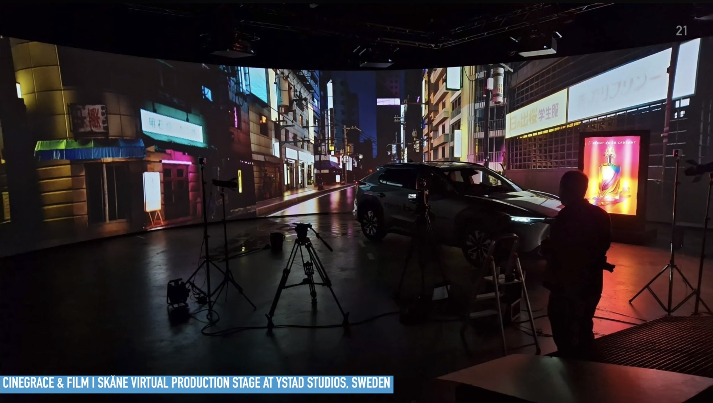
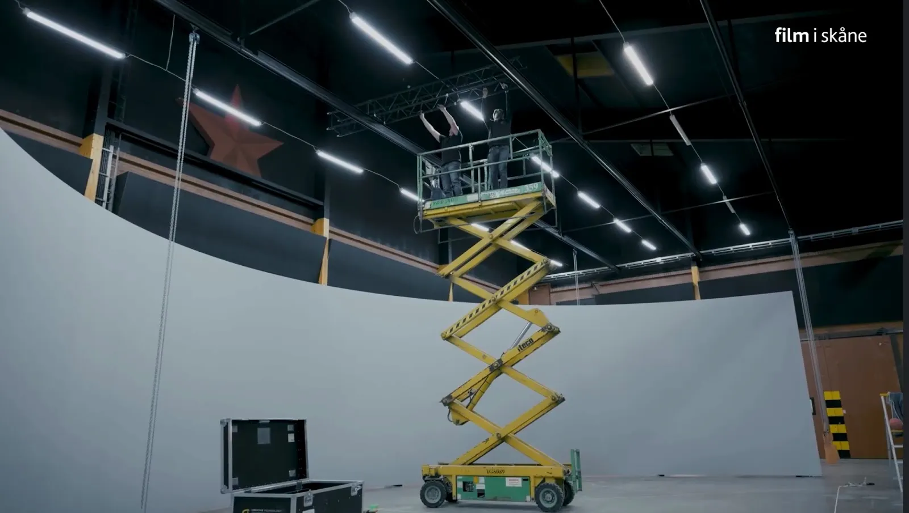
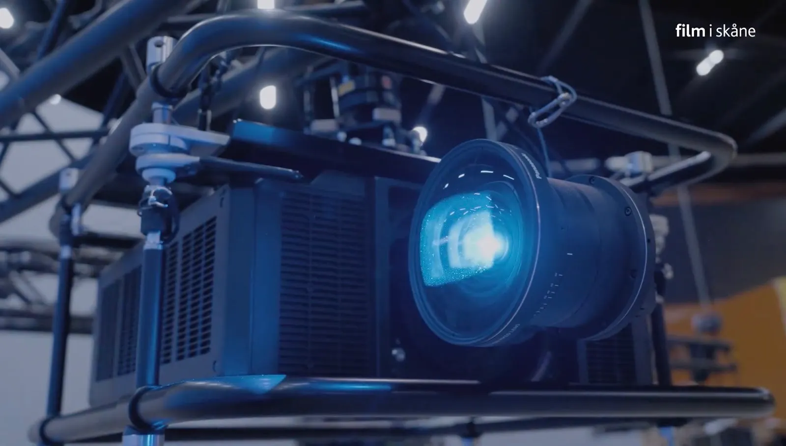

# Renaissance Pipeline

Renaissance is a production pipeline tuned for virtual production, visual effects, and XR media workflows. This webpage represents public launch of the [ATSF](https://github.com/ATSFSTUDIOS/) team co-developed in-house pipeline technology called "Renaissance" as a new code repository on GitHub. 

This R&D effort originally started out as a 2021 era "EPIC Megagrant" proposal submission for a hybrid unified pipeline that worked cross-DCC host, to allow as close to lossless data interchange with in-memory zero copy techniques for Renderless Compositing data bridging, when available by a programming API.

## Overview

The Renaissance Pipeline development efforts began, at full-speed in April 2021, as an idea to make an OpenXR multi-display based offshoot of the pre-existing immersive technology known as Kartaverse/KartaVR. The hope was to be able to adopt and build out a Khronos Group based industry standard XR stage solution of OpenXR and Vulkan graphics API that could help replace vendored proprietary rendering technologies that were very dominant at the time.

At its core, Renaissance was an innovative XR stage focused media server and bridge interface. It was developed as part of the planning process for a large-scale SciFi virtual production project based out of Sweden's [Ystad Studios](https://filmiskane.se/en/ystad-studios-english). The [key research](https://medium.com/@andrewhazelden/raytraced-volumetric-video-stitching-d907678d61f4) for Renaissance was focused on DLP projection based VP solutions as a way to avoid moire artifacts, improve color fidelity, and better control the price/performance aspects of budgeting for an in-house project-based XR stage studio rollout.

This research effort was done in collaboration with production partners Tobias Falk &amp; Tomas Wall of Cinegrace, [Film i Skåne](https://filmiskane.se/en/) (The Southern Sweden Film Commission), and Dover Studios, Inc. 

The core creative team for the VP effort included the [ATSF](https://www.imdb.com/title/tt35421453) show creator [Aurore de Blois](https://www.imdb.com/name/nm2642629/), [Doug Drexler](https://www.imdb.com/name/nm0237774/), and other collaborators. This was a seasoned crew of industry veterans, that had already worked for years and years on award winning science fiction shows like Star Trek (TNG to Picard), and Battlestar Galactica (2004-2009).

The Renaissance effort was originally conceived as part of a EPIC Megagrant submitted proposal for a hybrid unified pipeline architecture, that worked across numerous DCC hosts. The goal was to build out a lossless data interchange concept that was known internally as Renderless Compositing. It would go on to support with "in-memory zero copy" techniques for data bridging, when available by a host DCC package's programming API.

The Renaissance toolset is LGPL open-source licensed software. After many eyeons (meaning years and years), this innovative technology is finally getting a public release via the [Lightfielder GitHub repo](https://github.com/Lightfielder) in the month of November, 2026.

YouTube Short Video | Renaissance Pipeline for BMD Resolve Studio/Fusion  
https://www.youtube.com/shorts/vNXYkEilh2Y  

## OpenDisplayXR Journey

A version of the Renaissance XR stage focused ideas and concepts was built into the Stereo 3D multi-display demonstrator known at the time as [OpenDisplayXR](https://github.com/Lightfielder/OpenDisplayXR). Farhad at AMD helped provide gear access to Dover Studios, Inc. that allowed the OpenXR focused R&D to advance.

This OpenDisplayXR project's ideas were then remade by friends at Schneider Digital into the [ImmersaXR-Studio solution](https://www.schneider-digital.com/en/immersa-open-xr-studio-software/) that helps connect the OpenXR/WebXR APIs to Quadbuffer/Multibuffer Swapchain based stereoscopic displays. The ImmersaXR-Studio project received co-development funding which allowed the Schneider Digital lead development effort to be realized at the highest quality possible by [Harald Steinlechner](https://github.com/haraldsteinlechner) and his team at [Aardworx](https://www.aardworx.at/).

## XR Stage Gear Database 

The Kartaverse/Lightfielder project also hosts a mini [XR LED Panel Database](https://kartaverse.github.io/XR-LED-Panel-Database/) effort on GitHub, too. The database started from the research and code that [EmberlightVFX](https://www.emberlight.se/)'s Jacob Danell and I put into the [Camera Sensor Database](https://github.com/EmberLightVFX/Camera-Sensor-Database), and the [Reactor Standalone](https://github.com/Kartaverse/Reactor-Standalone) hosted atom package version of the same database.
